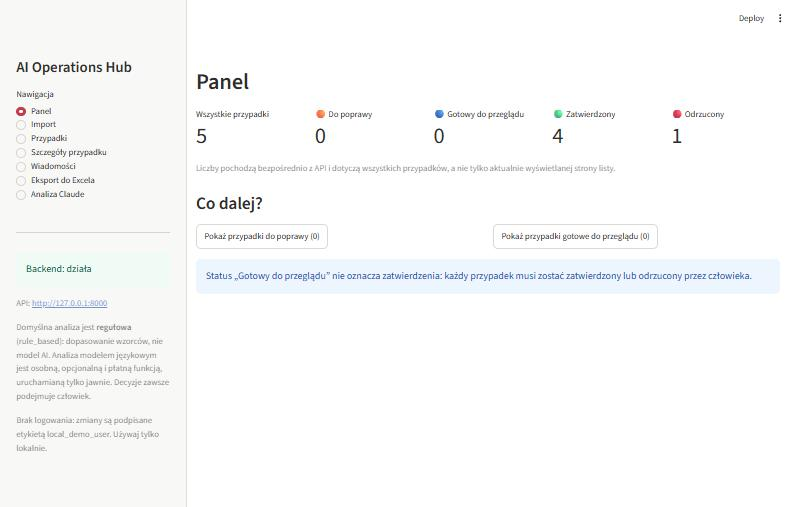
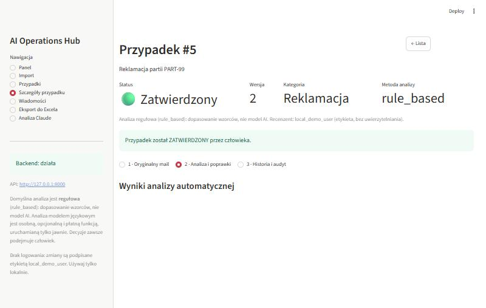
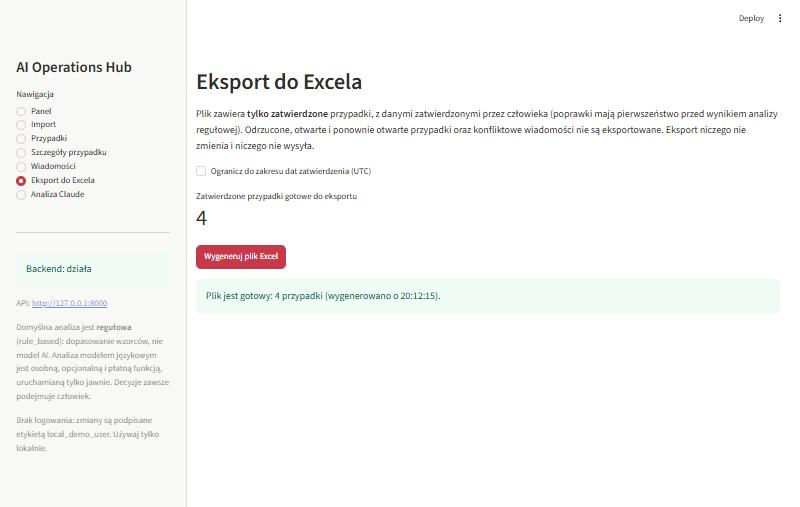
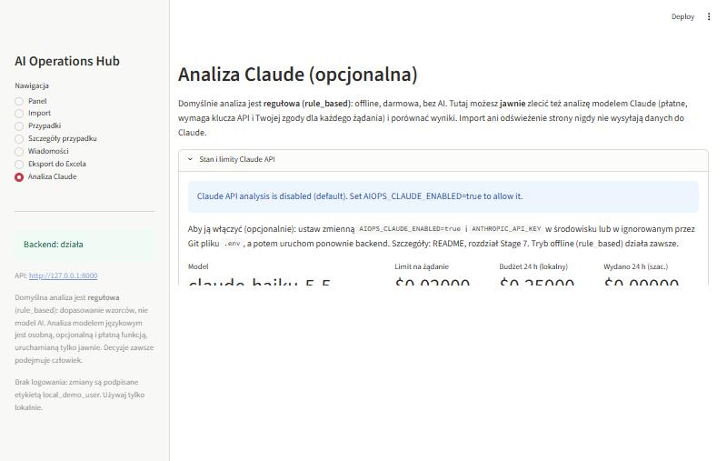

# AI Operations Hub

A **local, human-in-the-loop** workflow that turns business emails (orders, complaints, document requests) into reviewed,
auditable, exportable records. Personal portfolio project, built with fictional data only.

> **Honest status.** This is a demo of engineering practice, not a product. It has **no authentication**, binds to localhost only,
> and has never processed real mail. Extraction quality was measured only on small, self-written fictional datasets, so the numbers
> below are **not** real-world accuracy. The optional Claude API integration is verified **only against simulated providers and a
> mocked HTTP layer**: it has **never been called for real**. See [Limitations](#known-limitations).

## The business problem

Operations and back-office teams receive orders, complaints and document requests by email and retype the details into spreadsheets.
That is slow, error-prone and leaves no trail of who decided what. Fully automatic extraction is risky because a wrong amount or date
silently becomes a business fact.

This project explores a careful middle path:

1. **Import** an email (`.eml` file or pasted text) exactly once; identical re-imports are duplicates, same Message-ID with different
   content is a *conflict* that is kept, never overwritten.
2. **Suggest** a category and field values (reference, product, quantity, amount, dates, contacts) with the **exact source text** they
   came from, and flag what is ambiguous (for example a date without a year).
3. **A human reviews**: corrects values, approves or rejects. Anything that still looks wrong blocks approval unless the reviewer writes
   an explicit justification. Nothing is ever approved or sent automatically.
4. **Export** only the approved cases to Excel, with corrections, overrides and unconfirmed values clearly marked.

## Features

* Email parsing (`.eml`, pasted text) with size limits, deduplication and conflict detection; one SQLite transaction per import.
* Deterministic, offline **rule-based analyzer** (Polish and English) with source spans, validation status and warnings; prompt-injection
  detection. It is always labelled `rule_based` and is **not AI**.
* **FastAPI** case workflow: corrections (append-only), approve / reject / reopen, optimistic locking, audit trail, overrides.
* **Streamlit** interface (Polish) that talks to the API over HTTP only: dashboard, import, case list, case review, Excel export.
* **Excel export** of approved cases with formula-injection protection.
* **Optional Claude API analysis** (disabled by default, paid, explicit consent per request), compared read-only with the rule-based result.

## Screenshots

Fictional data, Polish UI, produced from the real application (Claude analysis was disabled, which is the default).

| Dashboard | Case review (approved, rule-based) |
|---|---|
|  |  |
| **Excel export** | **Claude analysis screen, disabled by default** |
|  |  |

## Architecture

```
 .eml / pasted text                              Streamlit UI (Polish)  --- HTTP only --->  FastAPI
        |                                         dashboard, import, review, export          |
        v                                                                                    v
  parsers + limits --> ImportService --> SQLite <-- repositories <-- services: Analysis, Case, Export, Claude
                        (dedup, conflict,    ^                            |          |          |
                         one transaction)    |                            v          v          v
                                  audit events, append-only        rule_based     openpyxl   Anthropic SDK
                                  corrections and decisions        analyzer       (.xlsx)    (optional, consent)
```

| Layer | Package | Responsibility |
|---|---|---|
| Parsing | `ai_ops_hub.parsing` | `.eml` and pasted text to a normalized message; size, MIME and header limits |
| Persistence | `ai_ops_hub.db`, `services/import_service` | SQLModel tables, DB-level constraints and triggers, deduplication, `BEGIN IMMEDIATE` writes |
| Analysis | `ai_ops_hub.analysis` | `Analyzer` protocol; rule-based implementation; evaluation harness |
| Cases | `ai_ops_hub.cases`, `services/case_service` | corrections, validation, status transitions, optimistic locking, audit |
| API | `ai_ops_hub.api` | FastAPI app, error envelope, size and cross-site guards, no business logic in routes |
| UI | `ai_ops_hub.ui` | Streamlit screens and a small HTTP client (no database access) |
| Export | `ai_ops_hub.export`, `services/export_service` | approved-only selection, workbook building, formula safety |
| Claude (optional) | `ai_ops_hub.analysis.claude`, `services/claude_service` | structured extraction, local verification, consent, cost reservation |

Key design decisions (details in [docs/TECHNICAL_NOTES.md](docs/TECHNICAL_NOTES.md)):

* **Provenance everywhere.** A value is stored with the exact text span it came from; spans are verified against the original.
* **Human decisions are explicit and auditable.** Corrections and review decisions are append-only (enforced by database triggers);
  approving a case with open problems needs a written override that is stored and exported.
* **Rules protect the data, not the model.** Even the optional language-model output is only a *suggestion*: quotes and values are
  re-verified locally and rejected when the email text does not support them.
* **Integrity in the database, not only in Python.** Uniqueness, conflict links and status rules are constraints and triggers.

## Technology

Python 3.11+, FastAPI, SQLModel/SQLAlchemy (SQLite, WAL), Pydantic v2, Streamlit, openpyxl, the official Anthropic Python SDK
(optional use), `httpx2`, pytest. No external service is needed to run the demo.

## Install and run on Windows

Prerequisites: Windows 10/11, **Python 3.11 or newer** (`py -3 --version`), Git. Open **PowerShell** or `cmd`.

```
git clone <your repository URL> AI-Operations-Hub
cd AI-Operations-Hub
py -3 -m venv .venv
.venv\Scripts\python -m pip install --upgrade pip
.venv\Scripts\python -m pip install -e ".[dev]"
.venv\Scripts\python -m pytest -q
```

Start the application in **two terminal windows**, both in the project folder:

```
.venv\Scripts\python -m ai_ops_hub.api --db data/local/demo.db
```
```
.venv\Scripts\python -m ai_ops_hub.ui
```

Open **http://127.0.0.1:8501**. The sidebar must show a green "Backend: działa". The data lives in `data/local/demo.db` (ignored by Git).
Stop both windows with `Ctrl+C`. The API's Swagger UI is at http://127.0.0.1:8000/docs.

## Offline demonstration (no account, no key, no network)

**In the browser** (Polish UI): follow [docs/DEMO_PL.md](docs/DEMO_PL.md): import a sample, review the suggestions, correct a value,
approve, reject, reopen, export to Excel. Sample emails are in `tests/data/samples/`.

**Scripted** (one command after the backend is running on a fresh database):

```
.venv\Scripts\python scripts/demo_api.py
```

It imports six fictional messages (a duplicate and a conflicting variant included), runs the rule-based analysis, approves, rejects
and overrides cases, exports the workbook and checks that it contains exactly the approved cases and no formula cells.
Expected ending: `OK: exactly the approved cases [1, 2, 3, 5] were exported ... no formula cells`.

## Optional: Claude API analysis

**Off by default. Real requests cost money and send the email text to Anthropic.** The rule-based analysis keeps working without it.

1. Create a key in the Anthropic Console and **set a billing limit there**.
2. Put these two lines in a local `.env` file in the project folder (Git ignores it; never commit a key):
   ```
   AIOPS_CLAUDE_ENABLED=true
   ANTHROPIC_API_KEY=sk-ant-...your key...
   ```
3. Restart the backend and open **Analiza Claude** in the UI. It shows the model, what will be sent (subject and body only), the
   destination host, the estimated and worst-case cost, and asks for an explicit consent for *each* request.

Controls: disabled by default; consent bound to the message, its content fingerprint, the model and the accepted cost; per-request
and 24-hour cost guards with an atomic budget **reserve** before sending; SDK retries off; a failed request stores no analysis; the
API key is only sent to `api.anthropic.com` (the `ANTHROPIC_BASE_URL` environment variable is deliberately ignored); the API refuses to
listen on a non-local address while Claude is enabled. The local budget is **not a guaranteed spending limit**: use the Console limit.
There is **no hard spending limit** in this code. Details and the one-test live procedure: [docs/TECHNICAL_NOTES.md](docs/TECHNICAL_NOTES.md#stage-7-optional-claude-api-analysis).

**Simulated vs real verification.** The tests drive the real Anthropic SDK over a *mocked* HTTP transport and fake providers. They prove
what the code *sends* and how it *parses* answers. They do **not** prove how well a real model extracts data, the real latency, the
real token counts or that the API accepts every parameter combination: that requires one authorized live test by the owner.

## Tests and measured results

```
.venv\Scripts\python -m pytest -q          # 1,453 tests, run offline, no network and no API key needed
```

* 1,453 automated tests: parsing, deduplication and concurrency, persistence constraints, analysis, case rules, API, UI (Streamlit
  `AppTest` against the real API), Excel safety, consent/budget/SDK behavior. A conftest guard fails any test that tries to reach a
  non-loopback host. Important safeguards were also checked with ad-hoc mutation testing (deliberately breaking the code and confirming
  that a test fails; the scripts are not part of the repository).
* **Rule-based extraction on fictional datasets** (`python -m ai_ops_hub.analysis.evaluation <file>`; reproducible offline):

  | Dataset | Cases | Category accuracy | Field precision | Field recall | F1 |
  |---|---|---|---|---|---|
  | `dataset_v1` (development) | 58 | 100% | 100% | 95.5% | 97.7% |
  | `dataset_challenge_v1` (hard cases) | 20 | 70% | 100% | 92.3% | 96.0% |
  | `dataset_holdout_v1` (held out) | 40 | 97.5% | 94.3% | 93.0% | 93.6% |

  **Read these with care:** the datasets were written by the same author as the rules, are tiny, fictional and mostly clean. They
  show the rules do what they were designed to do; they are **not** evidence of real-world accuracy. The datasets are never pooled.
* **Claude pipeline**: only a *simulated* check exists (`python -m ai_ops_hub.analysis.claude.benchmark <file> --simulate faithful`),
  which measures the local verification layer, not the model. Live benchmarking is disabled unless explicitly authorized.
* Manually checked in a real browser during development: import, review, approve/reject/reopen, Excel download, the consent flow
  (against a fake provider). Not checked: opening the `.xlsx` in Microsoft Excel itself.

## Security and privacy summary

Self-reviewed, with findings and fixes listed in [docs/SECURITY_REVIEW.md](docs/SECURITY_REVIEW.md): untrusted email text is treated
as data everywhere (escaped in the UI, never executed, spreadsheet formulas neutralised, prompt-injection flagged); secrets are never
stored or logged; the API and UI bind to `127.0.0.1` and refuse other addresses; browser cross-site writes are refused; the paid
API needs explicit consent and cannot be exposed to a network. **There is no authentication**, and the database stores email bodies
unencrypted. Use fictional data only.

## Known limitations

* Local demo only: **no authentication**, no multi-user support (changes are labelled `local_demo_user`), no deployment setup,
  no monitoring, SQLite only, UI in Polish only.
* The rule-based analyzer is pattern matching: it misses things, handles a limited set of Polish/English phrasings and formats, and
  cannot understand meaning. Quality on real mail is unknown.
* The Claude integration is **untested against the real API** (prompt, exact parameter combination `effort` + JSON schema, quality,
  latency and real cost are unverified). Cost estimates are approximate; the local budget is not a billing limit.
* An existing case cannot switch to another analysis (comparison is read-only) to protect the case history.
* Excel: only `.xlsx` exists (no CSV; CSV safety is not designed), at most 500 cases per file, not opened in Microsoft Excel in tests.
* No real email accounts, no sending, no Outlook/Gmail integration, by design.
* The UI is in Polish; API error messages, logs and the technical documentation are in English.

## Repository layout

```
src/ai_ops_hub/        application code (parsing, db, analysis, cases, api, ui, export, services)
tests/                 automated tests; tests/data/samples (fictional emails), tests/data/eval (labelled datasets)
scripts/demo_api.py    scripted offline demonstration
docs/                  DEMO_PL.md (Polish walkthrough), TECHNICAL_NOTES.md, SECURITY_REVIEW.md, RELEASE_CHECKLIST.md, images/
.env.example           documented configuration (no secrets)
```

## License

No license has been chosen yet, so by default all rights are reserved. See `docs/RELEASE_CHECKLIST.md` before making the
repository public.
